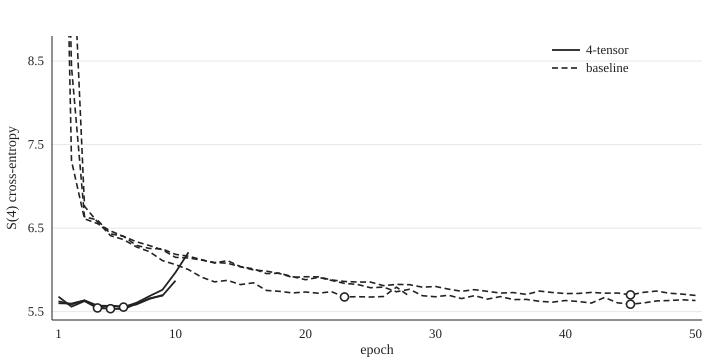
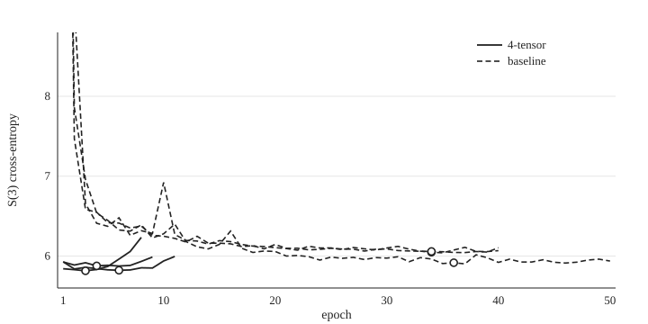
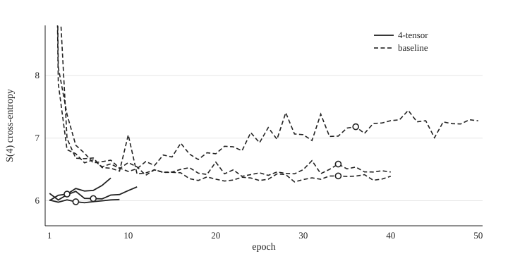
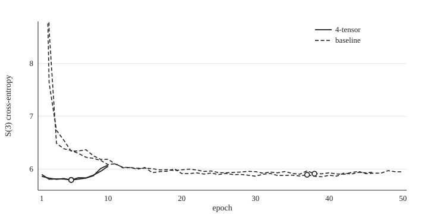
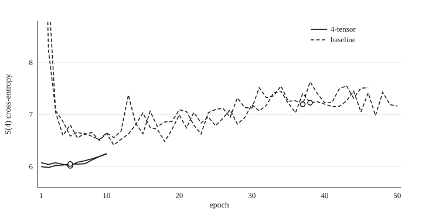

# semantic-world

**4-tensor attention for predicting the next semantic state of a scene.**

[](https://arxiv.org/abs/2610.11716)

This repository contains the model, the training code, and the comparison baseline for the paper *4-Tensor Attention Model for Semantic Physical Reality* (Jongwook Kim, Sangheon Yun).

---

## Why

We start from one premise: the semantic description of a physical scene is a compressed form of that scene. If so, a world model can advance a scene by evolving its description in discrete steps, instead of interpolating pixels or latents.

Video and world models that tokenize a scene usually flatten it into a single autoregressive sequence. That gives spatially simultaneous content an order it does not have, and leaves time to be recovered from one-dimensional position. Here each moment is compressed into one sentence-like state, time is kept as its own axis, and attention runs over the resulting *(position, time)* grid.


**Scope.** This repository implements and tests only the highlighted block. The image-to-text encoder, the text-to-image renderer, and any planner are outside it. To test the update on its own, the experiments run directly at the semantic layer on ROCStories. The one-step run conditions on four sentences and scores the fifth. A second run fixes the window at $T = 3$ and scores $\hat{S}(3)$, then $\hat{S}(4)$ from the model's own previous sentence.

---

## The model

### A window is a grid of tokens

A window of $T$ states, each padded to $N$ tokens, is a grid with time running down and token position running across:

| | $x=0$ | $1$ | $2$ | $3$ | $4$ | $5$ | $6$ | $7$ |
|---|---|---|---|---|---|---|---|---|
| $t=0$ | [I] | [am] | [in] | [front] | [of] | [the] | [elevator] | [0] |
| $t=1$ | [I] | [am] | [looking] | [at] | [the] | [floor] | [indicator] | [0] |
| $t=2$ | [The] | [elevator] | [arrives] | [at] | [my] | [floor] | [0] | [0] |

The running example in this section uses $T=3$ and $N=8$. The experiments use $T=4$ and $N=16$.

The grid above is the input window

$$
X(2) \leftarrow \{ S(0), S(1), S(2) \}.
$$

The training target is that window shifted by one sentence,

$$
X(3) \leftarrow \{ S(1), S(2), S(3) \},
$$

$S(1)$ and $S(2)$ repeat the rows $t=1$ and $t=2$ of the grid above. **$S(3)$** is the sentence absent from the input:

| | $x=0$ | $1$ | $2$ | $3$ | $4$ | $5$ | $6$ | $7$ |
|---|---|---|---|---|---|---|---|---|
| $t=1$ | [I] | [am] | [looking] | [at] | [the] | [floor] | [indicator] | [0] |
| $t=2$ | [The] | [elevator] | [arrives] | [at] | [my] | [floor] | [0] | [0] |
| **$t=3$** | **[The]** | **[elevator]** | **[doors]** | **[open]** | **[in]** | **[front]** | **[of]** | **[me]** |

$S(1)$ and $S(2)$ are the overlap of $X(2)$ and $X(3)$.

<table cellpadding="8" cellspacing="0" style="border-collapse: collapse;">
  <tr>
    <th style="border: 1px solid #d0d7de;"></th>
    <th align="left" style="border: 1px solid #d0d7de;">Training set</th>
    <th align="left" style="border: 1px solid #d0d7de;">Validation set</th>
  </tr>
  <tr>
    <td style="border: 1px solid #d0d7de;">4-tensor</td>
    <td style="border: 1px solid #d0d7de;"><em>W<sup>Q</sup></em>, <em>W<sup>K</sup></em>, <em>W<sup>V</sup></em>, and the other parameters are updated from that overlap, <em>S</em>(1) and <em>S</em>(2)</td>
    <td style="border: 1px solid #d0d7de;">Predicts <em>S</em>(3) in one parallel pass</td>
  </tr>
  <tr>
    <td style="border: 1px solid #d0d7de;">Baseline</td>
    <td style="border: 1px solid #d0d7de;">Updated from the whole of <em>X</em>(2): the non-padding tokens of <em>S</em>(0), <em>S</em>(1), <em>S</em>(2) concatenated, under a causal mask</td>
    <td style="border: 1px solid #d0d7de;">Free-running autoregressive prediction</td>
  </tr>
</table>

The grid and the table are the paper's running example. The paper uses $T=3$ so the shift is short enough to write out: the input sentences are $0$, $1$, and $2$, and the sentence to predict is $3$. The ROCStories validation experiment uses $T=4$. The model reads sentences $0$, $1$, $2$, and $3$, and the sentence it is scored on is $4$. That is the same shift with one more sentence in the window. The input is $X(3) \leftarrow \{S(0), S(1), S(2), S(3)\}$ and the target is $X(4) \leftarrow \{S(1), S(2), S(3), S(4)\}$. The overlap that updates the 4-tensor parameters is then $S(1)$, $S(2)$, and $S(3)$. The baseline is trained on the causal-masked non-padding concatenation of the whole input, $S(0)$ through $S(3)$. On the validation set the 4-tensor predicts $S(4)$ in one parallel pass, and the baseline free-runs. $S(4)$ is the sentence absent from the input.

In a standard transformer each token is a **vector** of width $d$. Here each cell of the grid holds a **matrix** of shape $d_x \times d_t$: one axis is the *semantic fiber* ($d_x$), the other the *temporal-context fiber* ($d_t$). The whole window is therefore a rank-4 tensor

$$
X \in \mathbb{R}^{N \times d_x \times T \times d_t}.
$$

### Every index of attention is doubled

| | Standard attention | 4-tensor attention |
|---|---|---|
| Position | $i$ | $(x,\, t)$ |
| Feature index | one index, width $d$ | $(n,\, q)$, widths $d_x$ and $d_t$ |
| Token representation | vector in $\mathbb{R}^{d}$ | matrix in $\mathbb{R}^{d_x \times d_t}$ |
| Projection | $W \in \mathbb{R}^{d \times d}$ | $W_{mn,pq} \in \mathbb{R}^{d_x \times d_x \times d_t \times d_t}$ |
| Score | $E_{ij}$ | $E_{xt,\,x't'}$ |
| Softmax runs over | keys $j$ | the key grid $(x',\, t')$ |
| Output | $y_i$ | $y_{xm;tp}$ |

With that table, the equations read exactly like ordinary attention.

**Projections** contract both input fibers at once:

$$
Q_{xm;tp} = \sum_{n,q} W^Q_{mn,pq}\, X_{xn;tq}, \qquad
K_{xm;tp} = \sum_{n,q} W^K_{mn,pq}\, X_{xn;tq}, \qquad
V_{xm;tp} = \sum_{n,q} W^V_{mn,pq}\, X_{xn;tq}.
$$

**Scores** contract both output fibers:

$$
E_{xt,\,x't'} = \frac{1}{\sqrt{d_x d_t}} \sum_{m,p} Q_{xm;tp}\, K_{x'm;t'p}.
$$

**Joint softmax** normalizes over the whole window at once, so any token of any state can be attended to:

$$
A_{xt,\,x't'} = \frac{\exp E_{xt,\,x't'}}{\sum_{x'',t''} \exp E_{xt,\,x''t''}}.
$$

**Output** has the same shape as the input:

$$
y_{xm;tp} = \sum_{x',t'} A_{xt,\,x't'}\, V_{x'm;t'p}.
$$

Only padding keys are masked. There is no temporal causal mask.

### Where information enters

Each signal is written into one fiber:

$$
X_{xn;tq} = \underbrace{E_{\mathrm{sem}}(\mathrm{tok}_{x,t})_n \, E_{\mathrm{temp}}(\mathrm{tok}_{x,t})_q}_{\text{token: rank-1 matrix}}
\;+\; \underbrace{P_{xn}}_{\text{position } x \text{ on } d_x}
\;+\; \underbrace{T^{\mathrm{emb}}_{xtq}}_{\text{phase } x+t \text{ on } d_t}
$$

$P$ and $T^{\mathrm{emb}}$ are fixed sinusoids. The readout ties the semantic fiber back to the same token table and learns only the temporal-context factor:

$$
L_{xv}(t) = \sum_{n,q} X^{\mathrm{norm}}_{xn;tq}\, E_{\mathrm{sem}}[v,n]\, W'_{q,v}.
$$

The logits at slice $t$ predict sentence $S(t+1)$, all $N$ tokens in one parallel pass.

### One layer

Pre-LN, with LayerNorm over the flattened $d_x d_t$ fiber at each $(x, t)$:

$$
X \leftarrow X + \mathrm{Dropout}\Big(\textstyle\sum_{h=1}^{H} \mathrm{Attn}^{(h)}(\mathrm{LN}(X))\Big), \qquad
X \leftarrow X + \mathrm{Dropout}\big(\mathrm{MLP}(\mathrm{LN}(X))\big).
$$

Each head keeps the full $(d_x, d_t)$ fiber, and heads are summed with no $1/\sqrt{H}$ factor and no output projection. The MLP acts on the flattened fiber with hidden width $4 d_x d_t$. A final LayerNorm precedes the readout.

### Where the structure acts

The projection $W_{mn,pq}$ is a general bilinear map on the joint $(n,q)$ space, so the two fibers may mix inside attention. The 4-tensor structure acts at the boundaries of the representation. A token enters as the tensor product $e_{\mathrm{sem}} \otimes e_{\mathrm{temp}}$ of a semantic vector and a temporal-context vector. Spatial position is written only on the $d_x$ fiber and temporal position only on the $d_t$ fiber. The readout is rank-1 in $(n,q)$ for each vocabulary item, with the semantic factor tied to the input dictionary. Attention then runs over the full $(x,t)$ grid, and the next state is read out for every position in parallel.

---

## Training and evaluation

Each stored window holds $T+1$ sentences $S(0), \ldots, S(T)$. The model reads $S(0), \ldots, S(T-1)$ and its targets are the same window shifted by one: $S(1), \ldots, S(T)$.

Training minimizes the cross-entropy over all $T$ target sentences. Because there is no temporal causal mask, the targets $S(1), \ldots, S(T-1)$ are already present in the input window; at the selected checkpoints their cross-entropy is $0.10$--$0.12$. **Prediction of an unseen sentence in the one-step experiment is measured only at $S(T)$**, and that is the number in the $T = 4$ table below. The $T = 3$ rollout scores $S(3)$ and $S(4)$ separately.

**Baseline.** A decoder-only causal transformer of width $d = d_x d_t$ reads the same window flattened into one string, `[BOS] S(0) … S(T-1)`, and generates $S(T)$ token by token, conditioning on its own argmax outputs (free-running), both in training and in evaluation. It never sees gold tokens of $S(T)$ on the input side. Its score is the cross-entropy on the same content tokens of $S(T)$. The 4-tensor loss is taken on all $T$ target sentences of the window; the baseline loss is taken only on the tokens of $S(T)$.

**Checkpoint.** Both models use AdamW at learning rate $3\times 10^{-4}$ and weight decay $0.01$, dropout $0.1$ on both residual branches, and a batch of $32$ per GPU ($64$ on two GPUs). Training stops once five epochs have passed since the minimum validation loss and the current loss exceeds $1.01$ times that minimum, or when the epoch budget is exhausted. For the 4-tensor model that minimum is the teacher-forced window cross-entropy on $S(1),\ldots,S(T)$. On four of the nine reported runs that epoch is also the minimum of $\mathcal{L}_{S(T)}$. For the baseline the minimum is the free-running cross-entropy of its own $S(T)$ tokens, including `[EOS]`. The table below drops `[EOS]` and keeps the content tokens only. With `--checkpoint_every 0` the run writes `best_<tag>.pt` at the selected epoch and `final_<tag>.pt` at the last epoch.

---

## Results

ROCStories, $T = 4$, $N = 16$, $d_x = 64$, $d_t = 32$. Validation split of 3,742 windows; the score is the mean cross-entropy over the 32,173 non-padding tokens of $S(4)$. Each setting is seeds 41, 42, and 43. A cell is 4-tensor / baseline: the mean and the sample standard deviation at each seed's own selected checkpoint.

| $H$ | $L$ | Parameters (4T / AR) | $\mathcal{L}_{S(4)}$ (4T / AR) | Token acc. % (4T / AR) | $\Delta$ |
|---:|---:|---:|---:|---:|---:|
| 2 | 2 | 122.2M / 175.9M | $5.580 \pm 0.017$ / $5.868 \pm 0.157$ | $16.4 \pm 0.6$ / $8.8 \pm 3.1$ | $0.288 \pm 0.165$ |
| 4 | 2 | 172.5M / 175.9M | $5.545 \pm 0.010$ / $5.655 \pm 0.059$ | $16.1 \pm 0.9$ / $11.3 \pm 1.6$ | $0.111 \pm 0.050$ |
| 4 | 3 | 256.4M / 226.2M | $5.536 \pm 0.005$ / $5.825 \pm 0.326$ | $16.0 \pm 0.5$ / $9.0 \pm 5.1$ | $0.290 \pm 0.321$ |

$\Delta = \mathcal{L}^{\mathrm{AR}}_{S(4)} - \mathcal{L}^{\mathrm{4T}}_{S(4)}$ on one seed. The table reports the mean and sample standard deviation of the three paired differences. Positive means the 4-tensor model is lower. Every seed's difference is positive. A uniform guess over the 36,711-token vocabulary scores $\ln 36711 \approx 10.51$.

| $H$ | $L$ | seed | Epoch (4T / AR) | $\mathcal{L}_{S(4)}$ (4T / AR) | Token acc. % (4T / AR) | $\Delta$ |
|---:|---:|---:|---:|---:|---:|---:|
| 2 | 2 | 41 | 7/12 / 32/37 | 5.582 / 6.023 | 16.7 / 6.8 | 0.440 |
| 2 | 2 | 42 | 4/9 / 54/61 | 5.596 / 5.708 | 15.8 / 12.4 | 0.112 |
| 2 | 2 | 43 | 4/9 / 30/39 | 5.562 / 5.873 | 16.8 / 7.3 | 0.311 |
| 4 | 2 | 41 | 4/9 / 23/28 | 5.544 / 5.676 | 17.0 / 13.1 | 0.131 |
| 4 | 2 | 42 | 5/10 / 45/50 | 5.535 / 5.589 | 15.3 / 10.2 | 0.054 |
| 4 | 2 | 43 | 6/11 / 45/50 | 5.554 / 5.701 | 16.0 / 10.5 | 0.147 |
| 4 | 3 | 41 | 7/12 / 13/18 | 5.541 / 6.200 | 16.5 / 3.3 | 0.659 |
| 4 | 3 | 42 | 6/11 / 29/35 | 5.531 / 5.667 | 15.4 / 11.1 | 0.136 |
| 4 | 3 | 43 | 6/11 / 33/40 | 5.534 / 5.608 | 16.1 / 12.7 | 0.074 |

Epoch is selected/last. The standard deviation at $H = 4$, $L = 3$ is carried by the baseline seed 41, selected at epoch 13 with cross-entropy $6.200$.

**Heads.** The two models use $H$ differently. The 4-tensor model adds full-size heads; the baseline splits $d$ across its heads.

| | 4-tensor | Baseline |
|---|---|---|
| Width of each head | full $(d_x, d_t)$ fiber, $d_x d_t$ | $d / H$ |
| Head merge | sum, no output projection | concatenation, then $W^O$ |
| Attention parameters per layer | $3Hd^2$ | $4d^2$ |
| MLP parameters per layer | $8d^2$ | $8d^2$ |
| Token table and readout | $\lvert V\rvert\,(d_x + 2d_t)$ | $(\lvert V\rvert + 2)\,d$, tied |

Biases and LayerNorm are omitted. With $d = 2048$, raising $H$ from 2 to 4 adds $6d^2 \approx 25.2$M parameters per layer to the 4-tensor model and none to the baseline, which is why the baseline count is the same in the first two rows of the results table. At $H = 4$, $L = 2$ the totals are close, but they are spent differently: the 4-tensor model puts 100.7M into attention and 4.7M into its token table, the baseline 33.6M and 75.2M.



These curves are the cross-entropy of $S(4)$ divided by the number of non-padding tokens. That mean is the quantity used for a fair comparison of the two models.


The figures are the closest parameter match, $H = 4$, $L = 2$, seeds 41, 42, and 43. Each solid curve is one 4-tensor seed and each dashed curve is the paired baseline. Open circles are that seed's selected checkpoint. The first figure is the validation cross-entropy of $S(4)$. Epoch 1 of each baseline lies above the plotted range ($14.99$--$18.03$). Epoch 2 of seed 41 is $10.27$ and also lies above it. The second figure is the training cross-entropy, with its own axis for each model. On the 4-tensor side the input is $X(3) \leftarrow \{S(0), S(1), S(2), S(3)\}$ and the loss is the mean cross-entropy of $X(4) \leftarrow \{S(1), S(2), S(3), S(4)\}$. Across the three seeds that loss goes from $2.289 \pm 0.097$ at epoch 1 to $1.471 \pm 0.043$ at the marked checkpoints, while $S(4)$ stays near $5.55$. The baseline loss is on $S(4)$ only. Its epoch 1 lies above the plotted range ($31.83$--$32.52$); epoch 2 lies inside. The third figure evaluates that same pair of windows on the validation split, input $X(3)$ and target $X(4)$. The marked 4-tensor validation losses are $1.308 \pm 0.005$, and each curve is higher afterward. The baseline validation loss at those checkpoints is $5.278 \pm 0.043$. Epoch 1 of those baseline curves is $13.49$--$17.13$, inside the plotted range. The horizontal axis is the epoch index, not wall-clock time: these 4-tensor runs took $2.0$--$2.4$ hours and the baseline runs took $25.1$--$45.2$ hours. Most of that gap is the training procedure, one sequential forward pass per target token. On every seed of this pair the lowest logged baseline content cross-entropy is above the lowest logged 4-tensor value, and the mean of those paired gaps is $0.110$. The tables use the selected checkpoint. For the baseline that checkpoint is chosen with `[EOS]` in the selection loss; on seed 43 the reported content cross-entropy is $5.701$ and the lowest logged content cross-entropy is $5.694$ at epoch 50.

Caveats: the checkpoint is selected on the same validation split that is reported. The $\pm$ values are the sample standard deviation over seeds 41, 42, and 43.

### Rollout of $S(3)$ and $S(4)$

The same five-sentence records are trained at window length $T = 3$. $S(4)$ is not a training target. The 4-tensor model reads $\{S(0), S(1), S(2)\}$ and is scored on $\{S(1), S(2), S(3)\}$ during training. At evaluation the first forward scores $\hat{S}(3)$ against $S(3)$, and the second reads $\{S(1), S(2), \hat{S}(3)\}$ and scores $\hat{S}(4)$ against $S(4)$. The baseline trains by free-running from `[BOS]` plus $S(0), S(1), S(2)$ onto $S(3)$ and `[EOS]`, then evaluates $\hat{S}(3)$ and $\hat{S}(4)$ with `[EOS]` removed from the denominator. The checkpoint is the minimum of that selection loss. The table is the two rollout scores at that checkpoint.

The denominators are 37,582 non-padding tokens of $S(3)$ and 32,173 of $S(4)$. A cell is 4-tensor / baseline. $H = 2$, $L = 2$ is seeds 41, 42, and 43, with 122.2M / 175.9M parameters. $H = 4$, $L = 2$ is seeds 41 and 42, with 172.5M / 175.9M parameters.

| $H$ | $L$ | Sentence | $\mathcal{L}$ (4T / AR) | Token acc. % (4T / AR) | $\Delta$ |
|---:|---:|---|---:|---:|---:|
| 2 | 2 | $S(3)$ | $5.838 \pm 0.034$ / $6.007 \pm 0.079$ | $14.1 \pm 0.1$ / $7.0 \pm 1.8$ | $0.169 \pm 0.067$ |
| 2 | 2 | $S(4)$ | $6.041 \pm 0.062$ / $6.721 \pm 0.410$ | $14.5 \pm 0.2$ / $2.0 \pm 1.5$ | $0.680 \pm 0.350$ |
| 4 | 2 | $S(3)$ | $5.795 \pm 0.002$ / $5.903 \pm 0.014$ | $13.9 \pm 0.3$ / $8.6 \pm 1.2$ | $0.108 \pm 0.016$ |
| 4 | 2 | $S(4)$ | $6.036 \pm 0.026$ / $7.217 \pm 0.021$ | $14.1 \pm 0.9$ / $0.6 \pm 0.1$ | $1.181 \pm 0.005$ |

$\Delta = \mathcal{L}^{\mathrm{AR}} - \mathcal{L}^{\mathrm{4T}}$ on one seed, then the mean and sample standard deviation of the paired differences in that row. Every paired difference is positive. At $H = 2$, $L = 2$ the relative reductions are $2.8\% \pm 1.1$ on $S(3)$ and $9.9\% \pm 4.5$ on $S(4)$. At $H = 4$, $L = 2$ they are $1.8\% \pm 0.3$ and $16.4\% \pm 0.1$.

| $H$ | $L$ | seed | Epoch (4T / AR) | $\mathcal{L}_{S(3)}$ | acc. $S(3)$ | $\Delta_{S(3)}$ | $\mathcal{L}_{S(4)}$ | acc. $S(4)$ | $\Delta_{S(4)}$ |
|---:|---:|---:|---:|---:|---:|---:|---:|---:|---:|
| 2 | 2 | 41 | 4/9 / 34/40 | 5.877 / 6.048 | 14.0 / 5.1 | 0.171 | 5.983 / 6.396 | 14.4 / 3.0 | 0.413 |
| 2 | 2 | 42 | 6/11 / 34/40 | 5.822 / 6.058 | 14.2 / 7.5 | 0.236 | 6.035 / 6.586 | 14.8 / 2.8 | 0.551 |
| 2 | 2 | 43 | 3/8 / 36/50 | 5.815 / 5.916 | 14.0 / 8.6 | 0.101 | 6.106 / 7.182 | 14.3 / 0.3 | 1.076 |
| 4 | 2 | 41 | 5/10 / 37/46 | 5.796 / 5.893 | 14.2 / 7.7 | 0.097 | 6.017 / 7.202 | 14.7 / 0.5 | 1.185 |
| 4 | 2 | 42 | 5/10 / 38/50 | 5.793 / 5.913 | 13.7 / 9.5 | 0.120 | 6.054 / 7.231 | 13.4 / 0.7 | 1.177 |









On every shared epoch the 4-tensor curve lies below the paired baseline. The open circle is the selection-loss minimum. For $S(3)$ that epoch is also the minimum of the plotted curve on two of the three 4-tensor runs at $H = 2$, $L = 2$ and on both 4-tensor runs at $H = 4$, $L = 2$. For $S(4)$ it is that minimum on the 4-tensor seed 41 at $H = 4$, $L = 2$, and the selected epoch differs from that minimum on each of the other nine runs. At $H = 2$, $L = 2$, epoch 1 of each baseline lies above the plotted range, $15.92$--$17.07$ on $S(3)$ and $17.02$--$20.03$ on $S(4)$, and epoch 2 of seed 41 is $9.15$ and $9.60$. At $H = 2$, $L = 2$ the mean paired gaps of the trajectory minima are $0.158$ on $S(3)$ and $0.392$ on $S(4)$, and the gaps at the selected checkpoints are $0.169 \pm 0.067$ and $0.680 \pm 0.350$. The $S(4)$ standard deviation is carried by baseline seed 43: the reported cross-entropy is $7.182$ at epoch 36, the run ends at epoch 50 because the budget is exhausted, and the lowest logged $S(4)$ is $6.467$ at epoch 10. The perplexities of the mean cross-entropies are $343$ and $406$ on $S(3)$, and $420$ and $830$ on $S(4)$. Those 4-tensor runs took $1.1$--$1.5$ hours and the baseline runs took $32.9$--$41.3$ hours. At $H = 4$, $L = 2$ the paired gaps of the trajectory minima are $0.084$ on $S(3)$ and $0.470$ on $S(4)$, and the gaps at the selected checkpoints are $0.108 \pm 0.016$ and $1.181 \pm 0.005$. Epoch 1 of each baseline lies above the range, $14.22$--$16.38$ on $S(3)$ and $14.57$--$17.46$ on $S(4)$, and epoch 2 of seed 41 on $S(4)$ is $9.43$. Both baseline seeds are selected with $S(4)$ near $7.2$ and accuracy $0.5\%$ and $0.7\%$. Seed 42 ends at epoch 50 because the budget is exhausted, selected at epoch 38, and its lowest logged $S(4)$ is $6.418$ at epoch 11. Seed 41 stops at epoch 46, selected at epoch 37, and its lowest logged $S(4)$ is $6.524$ at epoch 9. The perplexities of the mean cross-entropies are $329$ and $366$ on $S(3)$, and $418$ and $1{,}362$ on $S(4)$. Those 4-tensor runs each took $1.7$ hours and the baseline runs took $37.9$--$40.8$ hours.

---

## Repository layout

```
four_tensor_model.py              input construction, rank-4 heads, Pre-LN layer, tied readout
four_tensor_train.py              training loop and checkpoint selection for the 4-tensor model
baseline_ar_attention_model.py    free-running 1-D baseline
baseline_ar_attention_train.py    training loop for the baseline
data_rocstories.py                ROCStories CSVs to a token-window pool
four_tensor_readme.md             construction notes for the 4-tensor pipeline
baseline_ar_attention_readme.md   construction notes for the free-running baseline
export_dynamics.py                epoch logs to the curves in docs/ and figures/dynamics/
run_rocstories_train.sh           launcher; the training knobs live in this file
docs/h4l2_s4_ce.svg               validation S(4) curves for H=4, L=2, seeds 41--43
docs/h4l2_train_ce.svg            training CE for H=4, L=2, one axis per model
docs/h4l2_val_ce.svg              validation CE for H=4, L=2, one axis per model
docs/h2l2_rollout_s3_ce.svg       rollout S(3) curves for H=2, L=2, seeds 41--43
docs/h2l2_rollout_s4_ce.svg       rollout S(4) curves for H=2, L=2, seeds 41--43
docs/h4l2_rollout_s3_ce.svg       rollout S(3) curves for H=4, L=2, seeds 41 and 42
docs/h4l2_rollout_s4_ce.svg       rollout S(4) curves for H=4, L=2, seeds 41 and 42
figures/rollout/                  per-epoch rollout S(3) and S(4) for h2l2 and h4l2
figures/dynamics/                 per-epoch S(4), training CE, and validation CE
                                  for h2l2, h4l2, and h4l3, seeds 41, 42, and 43
rocstories/                       story CSVs and cloze CSVs
rocstories_T4max_x16/
    psf_pool_T4_N16.jsonl         token windows, T=4, N=16
    psf_pool_T4_N16.vocab.json
    psf_pool_T4_N16.meta.json
    output_four_tensor_preLN/     epoch logs (.json, .jsonl, .log)
    output_baseline_ar_attention_preLN/
    output_four_tensor_rollout/    T=3 rollout logs
    output_baseline_ar_attention_rollout/
```

The training scripts have no flag defaults. Every value is passed on the command line. `data_rocstories.py` does have defaults (`T=4`, `N=16`). A trainer reads the first `psf_pool_*.jsonl` in `--data_dir`, in sorted order. Windows labeled `train` or `dev` are the training split; windows labeled `test` are the validation split. More than one visible GPU wraps the model in `DataParallel`, and `--batch_size` is the batch per GPU.

Each logged run is three files that share the run tag: a summary `.json`, an epoch `.jsonl`, and a `.log`. `output_four_tensor_preLN/` and `output_baseline_ar_attention_preLN/` each hold the three reported settings at seeds 41, 42, and 43. `export_dynamics.py` reads those `.jsonl` files and rewrites `figures/dynamics/` and the three SVGs in `docs/`. A training run also writes `best_<tag>.pt` and `final_<tag>.pt`; those weight files are outside this tree.

## Quickstart

Python 3, PyTorch with CUDA, and NumPy. The reported runs used Python 3.12 and PyTorch 2.7 on two RTX 3080 GPUs.

The ROCStories files are in `rocstories/`: the spring 2016 and winter 2017 story CSVs, named `ROCStories*.csv`, and the cloze files `cloze_test_val*.csv` and `cloze_test_test*.csv`. The corpus is Mostafazadeh et al., *A Corpus and Cloze Evaluation for Deeper Understanding of Commonsense Stories*, NAACL 2016. The vocabulary is built on the full pool, including the validation stories. The baseline then appends `[BOS]` and `[EOS]`.

`psf_pool_T4_N16.meta.json` records the files that entered the pool: both story CSVs, the spring 2016 cloze validation and test files, and the winter 2018 cloze validation file (15 stories). The winter 2018 cloze test file is in `rocstories/` and has no `AnswerRightEnding` column, so the loader leaves it out.

The token pool for the reported runs is already written as `rocstories_T4max_x16/psf_pool_T4_N16.jsonl`, with `.vocab.json` and `.meta.json`. Rebuilding it overwrites those three files:

```bash
python data_rocstories.py --data_dir rocstories --T 4 --max_x 16 --out_dir rocstories_T4max_x16
```

Sentences longer than 16 tokens are truncated, and shorter ones are padded with index 0. The loader in this tree is `data_rocstories.py`. `run_rocstories_train.sh` reuses `rocstories_T4max_x16` when those three pool files are already present. When they are absent it calls `four_tensor_data_rocstories.py`, so rebuild the pool with the command above before using the shell script on an empty data directory. The knobs currently set in the shell script are $H=2$, $L=2$, seed 43.

The commands below reproduce one run of the closest parameter match, $H=4$, $L=2$, seed 43, with an epoch budget of 50. Seeds 41 and 42 of $H=2$, $L=2$ and of $H=4$, $L=2$ use the same flags with an epoch budget of 100. Every $H=4$, $L=3$ run uses a budget of 100; the baseline seed 42 stopped at epoch 35. If DataLoader workers fail to start, set `--num_workers 0`.

```bash
python four_tensor_train.py \
  --data_dir rocstories_T4max_x16 \
  --output_dir rocstories_T4max_x16/output_four_tensor_preLN \
  --run_tag rocstories_T4N16_dx64_dt32_H4L2_do0.1_b32_s43 \
  --d_x 64 --d_t 32 --n_heads 4 --n_layers 2 \
  --dropout 0.1 --padding_idx 0 \
  --epochs 50 --batch_size 32 --lr 0.0003 --optimizer adamw \
  --num_workers 2 --seed 43 --deterministic true \
  --save_checkpoints true --resume_from_checkpoint false \
  --stop_at_val_minimum true --val_minimum_patience 5 --val_minimum_ratio 1.01 \
  --checkpoint_every 0
```

```bash
python baseline_ar_attention_train.py \
  --data_dir rocstories_T4max_x16 \
  --output_dir rocstories_T4max_x16/output_baseline_ar_attention_preLN \
  --run_tag rocstories_T4N16_dx64_dt32_H4L2_do0.1_b32_s43 \
  --d_x 64 --d_t 32 --n_heads 4 --n_layers 2 \
  --dropout 0.1 --padding_idx 0 \
  --epochs 50 --batch_size 32 --lr 0.0003 --optimizer adamw \
  --num_workers 2 --seed 43 --deterministic true \
  --save_checkpoints true --resume_from_checkpoint false \
  --stop_at_val_minimum true --val_minimum_patience 5 --val_minimum_ratio 1.01 \
  --checkpoint_every 0
```

---

## Where this is going

The two fibers are kept as distinct tensor factors at the input and the readout, while the internal projection may mix them freely. The architecture does not force transition rules to separate from the objects they act on, but it keeps a representation in which that separation can be learned and tested. A next question is whether such a learner can acquire, without structural annotation, an operation whose output fills its own argument slot. Nested containment is a minimal case; with identical containers the iteration takes the form of Zermelo's successor construction, $0 = \varnothing$, $n+1 = \lbrace n \rbrace$.

## Citation

```bibtex
@misc{kim2026semanticworld,
  title         = {4-Tensor Attention Model for Semantic Physical Reality},
  author        = {Kim, Jongwook and Yun, Sangheon},
  year          = {2026},
  eprint        = {2610.11716},
  archivePrefix = {arXiv},
  primaryClass  = {cs.LG},
  url           = {https://arxiv.org/abs/2610.11716}
}
```

## License and Patent Notice

**Patent pending.** The methods in this repository are the subject of a pending Korean patent application (Application No. 10-2026-0191535, filed 2026-10-06) by IndigoWave Inc.

**All rights reserved.** No license is granted at this time. You may view the code, but you may not copy, modify, or redistribute it without permission. No patent license is granted, expressly or by implication, by making this repository available.

Researchers interested in using these methods are welcome to contact us for research collaboration or permission requests.

Contact: <indigowave511@gmail.com>
