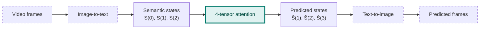
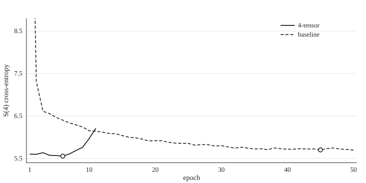
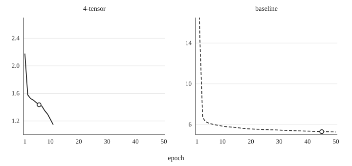
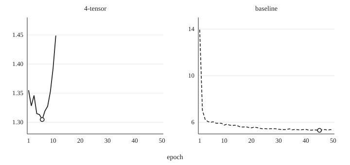

# semantic-world

**4-tensor attention for predicting the next semantic state of a scene.**

This repository contains the model, the training code, and the comparison baseline for the paper *4-Tensor Attention Model for Semantic Physical Reality* (Jongwook Kim, Sangheon Yun).

---

## Why

We start from one premise: the semantic description of a physical scene is a compressed form of that scene. If so, a world model can advance a scene by evolving its description in discrete steps, instead of interpolating pixels or latents.

Video and world models that tokenize a scene usually flatten it into a single autoregressive sequence. That gives spatially simultaneous content an order it does not have, and leaves time to be recovered from one-dimensional position. Here each moment is compressed into one sentence-like state, time is kept as its own axis, and attention runs over the resulting *(position, time)* grid.



**Scope.** This repository implements and tests only the highlighted block. The image-to-text encoder, the text-to-image renderer, and any planner are outside it. To test the update on its own, the experiments run directly at the semantic layer on ROCStories, where every window poses the same task: given four sentences, predict the fifth.

---

## The model

### A window is a grid of tokens

A window of $T$ states, each padded to $N$ tokens, is a grid with time running down and token position running across:

```
           x = 0       1          2         3        ...
  t = 0    [I]        [am]       [in]      [front]   ...
  t = 1    [I]        [am]       [looking] [at]      ...
  t = 2    [The]      [elevator] [arrives] [at]      ...
```

In a standard transformer each token is a **vector** of width $d$. Here each cell of the grid holds a **matrix** of shape $d_x \times d_t$: one axis is the *semantic fiber* ($d_x$), the other the *temporal-context fiber* ($d_t$). The whole window is therefore a rank-4 tensor

$$
X \in \mathbb{R}^{N \times d_x \times T \times d_t}.
$$

### Every index of attention is doubled

| | Standard attention | 4-tensor attention |
|---|---|---|
| Position | $i$ | $(x,\, t)$ |
| Feature index | one index, width $d$ | $(n,\, q)$, widths $d_x$ and $d_t$ |
| Token representation | vector in $\mathbb{R}^{d}$ | matrix in $\mathbb{R}^{d_x \times d_t}$ |
| Projection | $W \in \mathbb{R}^{d \times d}$ | $W_{mn,pq} \in \mathbb{R}^{d_x \times d_x \times d_t \times d_t}$ |
| Score | $E_{ij}$ | $E_{xt,\,x't'}$ |
| Softmax runs over | keys $j$ | the key grid $(x',\, t')$ |
| Output | $y_i$ | $y_{xm;tp}$ |

With that table, the equations read exactly like ordinary attention.

**Projections** contract both input fibers at once:

$$
Q_{xm;tp} = \sum_{n,q} W^Q_{mn,pq}\, X_{xn;tq}, \qquad
K_{xm;tp} = \sum_{n,q} W^K_{mn,pq}\, X_{xn;tq}, \qquad
V_{xm;tp} = \sum_{n,q} W^V_{mn,pq}\, X_{xn;tq}.
$$

**Scores** contract both output fibers:

$$
E_{xt,\,x't'} = \frac{1}{\sqrt{d_x d_t}} \sum_{m,p} Q_{xm;tp}\, K_{x'm;t'p}.
$$

**Joint softmax** normalizes over the whole window at once, so any token of any state can be attended to:

$$
A_{xt,\,x't'} = \frac{\exp E_{xt,\,x't'}}{\sum_{x'',t''} \exp E_{xt,\,x''t''}}.
$$

**Output** has the same shape as the input:

$$
y_{xm;tp} = \sum_{x',t'} A_{xt,\,x't'}\, V_{x'm;t'p}.
$$

Only padding keys are masked. There is no temporal causal mask.

### Where information enters

Each signal is written into one fiber:

$$
X_{xn;tq} = \underbrace{E_{\mathrm{sem}}(\mathrm{tok}_{x,t})_n \, E_{\mathrm{temp}}(\mathrm{tok}_{x,t})_q}_{\text{token: rank-1 matrix}}
\;+\; \underbrace{P_{xn}}_{\text{position } x \text{ on } d_x}
\;+\; \underbrace{T^{\mathrm{emb}}_{xtq}}_{\text{phase } x+t \text{ on } d_t}
$$

$P$ and $T^{\mathrm{emb}}$ are fixed sinusoids. The readout ties the semantic fiber back to the same token table and learns only the temporal-context factor:

$$
L_{xv}(t) = \sum_{n,q} X^{\mathrm{norm}}_{xn;tq}\, E_{\mathrm{sem}}[v,n]\, W'_{q,v}.
$$

The logits at slice $t$ predict sentence $S(t+1)$, all $N$ tokens in one parallel pass.

### One layer

Pre-LN, with LayerNorm over the flattened $d_x d_t$ fiber at each $(x, t)$:

$$
X \leftarrow X + \mathrm{Dropout}\Big(\textstyle\sum_{h=1}^{H} \mathrm{Attn}^{(h)}(\mathrm{LN}(X))\Big), \qquad
X \leftarrow X + \mathrm{Dropout}\big(\mathrm{MLP}(\mathrm{LN}(X))\big).
$$

Each head keeps the full $(d_x, d_t)$ fiber, and heads are summed with no $1/\sqrt{H}$ factor and no output projection. The MLP acts on the flattened fiber with hidden width $4 d_x d_t$. A final LayerNorm precedes the readout.

### Where the structure acts

The projection $W_{mn,pq}$ is a general bilinear map on the joint $(n,q)$ space, so the two fibers may mix inside attention. The 4-tensor structure acts at the boundaries of the representation. A token enters as the tensor product $e_{\mathrm{sem}} \otimes e_{\mathrm{temp}}$ of a semantic vector and a temporal-context vector. Spatial position is written only on the $d_x$ fiber and temporal position only on the $d_t$ fiber. The readout is rank-1 in $(n,q)$ for each vocabulary item, with the semantic factor tied to the input dictionary. Attention then runs over the full $(x,t)$ grid, and the next state is read out for every position in parallel.

---

## Training and evaluation

Each stored window holds $T+1$ sentences $S(0), \ldots, S(T)$. The model reads $S(0), \ldots, S(T-1)$ and its targets are the same window shifted by one: $S(1), \ldots, S(T)$.

Training minimizes the cross-entropy over all $T$ target sentences. Because there is no temporal causal mask, the targets $S(1), \ldots, S(T-1)$ are already present in the input window; at the selected checkpoints their cross-entropy is about $0.1$. **Prediction of an unseen sentence is measured only at $S(T)$**, and that is the number used for every comparison.

**Baseline.** A decoder-only causal transformer of width $d = d_x d_t$ reads the same window flattened into one string, `[BOS] S(0) … S(T-1)`, and generates $S(T)$ token by token, conditioning on its own argmax outputs (free-running), both in training and in evaluation. It never sees gold tokens of $S(T)$ on the input side. Its score is the cross-entropy on the same content tokens of $S(T)$. The 4-tensor loss is taken on all $T$ target sentences of the window; the baseline loss is taken only on the tokens of $S(T)$.

**Checkpoint.** Both models use AdamW at learning rate $3\times 10^{-4}$ and weight decay $0.01$, dropout $0.1$ on both residual branches, and a batch of $32$ per GPU ($64$ on two GPUs). Training stops once five epochs have passed since the minimum validation loss and the current loss exceeds $1.01$ times that minimum, or when the epoch budget is exhausted. For the 4-tensor model that minimum is the teacher-forced window cross-entropy on $S(1),\ldots,S(T)$. On every reported setting this is the same epoch as the minimum of $\mathcal{L}_{S(T)}$. For the baseline the minimum is the free-running cross-entropy of its own $S(T)$ tokens, including `[EOS]`. The table below drops `[EOS]` and keeps the content tokens only. With `--checkpoint_every 0` the run writes `best_<tag>.pt` at the selected epoch and `final_<tag>.pt` at the last epoch.

---

## Results

ROCStories, $T = 4$, $N = 16$, $d_x = 64$, $d_t = 32$. Validation split of 3,742 windows; the score is the mean cross-entropy over the 32,173 non-padding tokens of $S(4)$. One seed per setting.

| $H$ | $L$ | seed | Epoch (4T / AR) | Parameters (4T / AR) | $\mathcal{L}_{S(4)}$ (4T / AR) | Token acc. % (4T / AR) | $\Delta$ |
|---:|---:|---:|---:|---:|---:|---:|---:|
| 2 | 2 | 43 | 4/9 / 30/39 | 122.2M / 175.9M | 5.562 / 5.873 | 16.8 / 7.3 | 0.311 |
| 4 | 2 | 43 | 6/11 / 45/50 | 172.5M / 175.9M | 5.554 / 5.701 | 16.0 / 10.5 | 0.147 |
| 4 | 3 | 42 | 6/11 / 29/35 | 256.4M / 226.2M | 5.531 / 5.667 | 15.4 / 11.1 | 0.136 |

$\Delta = \mathcal{L}^{\mathrm{AR}}_{S(4)} - \mathcal{L}^{\mathrm{4T}}_{S(4)}$; positive means the 4-tensor model is lower. A uniform guess over the 36,711-token vocabulary scores $\ln 36711 \approx 10.51$.







The figures are the closest parameter match, $H = 4$, $L = 2$, seed 43. Open circles are the checkpoints in the table. The first figure is the validation cross-entropy of $S(4)$: the solid curve is the 4-tensor model and the dashed curve is the baseline. Epoch 1 of the baseline there is $14.99$ and lies above the plotted range. The second figure is the training cross-entropy, the mean each optimizer steps on, with its own axis for each model. The 4-tensor loss averages every target sentence, so it falls from $2.178$ at epoch 1 to $1.435$ at the marked checkpoint while $S(4)$ stays near $5.55$. The baseline loss is on $S(4)$ only. Its epoch 1 is $32.52$ and lies above the plotted range; epoch 2 is $14.58$. The third figure is the same mean on the validation split. For this pair the 4-tensor validation loss reaches $1.305$ at the marked checkpoint and is higher afterward. The baseline validation loss at that checkpoint is $5.310$, and epoch 1 of that curve is $13.95$, inside the plotted range. The horizontal axis is the epoch index, not wall-clock time: this pair took $2.4$ hours and $45.2$ hours. Most of that gap is the training procedure, one sequential forward pass per target token. Over every logged epoch of this pair, the lowest baseline content cross-entropy is $5.694$ at epoch 50, above the 4-tensor minimum $5.554$. The table's $5.701$ is the checkpoint chosen with `[EOS]` included in the baseline loss.

Caveats: the checkpoint is selected on the same validation split that is reported, and each setting has a single seed.

---

## Repository layout

```
four_tensor_model.py              input construction, rank-4 heads, Pre-LN layer, tied readout
four_tensor_train.py              training loop and checkpoint selection for the 4-tensor model
baseline_ar_attention_model.py    free-running 1-D baseline
baseline_ar_attention_train.py    training loop for the baseline
data_rocstories.py                ROCStories CSVs to a token-window pool
four_tensor_readme.md             construction notes for the 4-tensor pipeline
baseline_ar_attention_readme.md   construction notes for the free-running baseline
export_dynamics.py                epoch logs to the curves in docs/ and figures/dynamics/
run_rocstories_train.sh           launcher; the training knobs live in this file
docs/h4l2_s4_ce.svg               validation S(4) curve for H=4, L=2
docs/h4l2_train_ce.svg            training CE for H=4, L=2, one axis per model
docs/h4l2_val_ce.svg              validation CE for H=4, L=2, one axis per model
figures/dynamics/                 per-epoch S(4), training CE, and validation CE
                                  for h2l2_s43, h4l2_s43, and h4l3_s42
rocstories/                       story CSVs and cloze CSVs
rocstories_T4max_x16/
    psf_pool_T4_N16.jsonl         token windows, T=4, N=16
    psf_pool_T4_N16.vocab.json
    psf_pool_T4_N16.meta.json
    output_four_tensor_preLN/     epoch logs (.json, .jsonl, .log)
    output_baseline_ar_attention_preLN/
```

The training scripts have no flag defaults. Every value is passed on the command line. `data_rocstories.py` does have defaults (`T=4`, `N=16`). A trainer reads the first `psf_pool_*.jsonl` in `--data_dir`, in sorted order. Windows labeled `train` or `dev` are the training split; windows labeled `test` are the validation split. More than one visible GPU wraps the model in `DataParallel`, and `--batch_size` is the batch per GPU.

Each logged run is three files that share the run tag: a summary `.json`, an epoch `.jsonl`, and a `.log`. `output_four_tensor_preLN/` holds the three reported settings and one further log, `H3L2` with seed 43, which is outside the table. `output_baseline_ar_attention_preLN/` holds the three reported settings. `export_dynamics.py` reads the reported `.jsonl` files and rewrites `figures/dynamics/` and the three SVGs in `docs/`. A training run also writes `best_<tag>.pt` and `final_<tag>.pt`; those weight files are outside this tree.

## Quickstart

Python 3, PyTorch with CUDA, and NumPy. The reported runs used Python 3.12 and PyTorch 2.7 on two RTX 3080 GPUs.

The ROCStories files are in `rocstories/`: the spring 2016 and winter 2017 story CSVs, named `ROCStories*.csv`, and the cloze files `cloze_test_val*.csv` and `cloze_test_test*.csv`. The corpus is Mostafazadeh et al., *A Corpus and Cloze Evaluation for Deeper Understanding of Commonsense Stories*, NAACL 2016. The vocabulary is built on the full pool, including the validation stories. The baseline then appends `[BOS]` and `[EOS]`.

`psf_pool_T4_N16.meta.json` records the files that entered the pool: both story CSVs, the spring 2016 cloze validation and test files, and the winter 2018 cloze validation file (15 stories). The winter 2018 cloze test file is in `rocstories/` and has no `AnswerRightEnding` column, so the loader leaves it out.

The token pool for the reported runs is already written as `rocstories_T4max_x16/psf_pool_T4_N16.jsonl`, with `.vocab.json` and `.meta.json`. Rebuilding it overwrites those three files:

```bash
python data_rocstories.py --data_dir rocstories --T 4 --max_x 16 --out_dir rocstories_T4max_x16
```

Sentences longer than 16 tokens are truncated, and shorter ones are padded with index 0. The loader in this tree is `data_rocstories.py`. `run_rocstories_train.sh` reuses `rocstories_T4max_x16` when those three pool files are already present. When they are absent it calls `four_tensor_data_rocstories.py`, so rebuild the pool with the command above before using the shell script on an empty data directory. The knobs currently set in the shell script are $H=2$, $L=2$, seed 43.

The commands below reproduce the closest parameter match, $H=4$, $L=2$, seed 43, with an epoch budget of 50. The other rows use the same flags with their own head count, layer count, and seed. The $H=4$, $L=3$ baseline was given an epoch budget of 100 and stopped at epoch 35. If DataLoader workers fail to start, set `--num_workers 0`.

```bash
python four_tensor_train.py \
  --data_dir rocstories_T4max_x16 \
  --output_dir rocstories_T4max_x16/output_four_tensor_preLN \
  --run_tag rocstories_T4N16_dx64_dt32_H4L2_do0.1_b32_s43 \
  --d_x 64 --d_t 32 --n_heads 4 --n_layers 2 \
  --dropout 0.1 --padding_idx 0 \
  --epochs 50 --batch_size 32 --lr 0.0003 --optimizer adamw \
  --num_workers 2 --seed 43 --deterministic true \
  --save_checkpoints true --resume_from_checkpoint false \
  --stop_at_val_minimum true --val_minimum_patience 5 --val_minimum_ratio 1.01 \
  --checkpoint_every 0
```

```bash
python baseline_ar_attention_train.py \
  --data_dir rocstories_T4max_x16 \
  --output_dir rocstories_T4max_x16/output_baseline_ar_attention_preLN \
  --run_tag rocstories_T4N16_dx64_dt32_H4L2_do0.1_b32_s43 \
  --d_x 64 --d_t 32 --n_heads 4 --n_layers 2 \
  --dropout 0.1 --padding_idx 0 \
  --epochs 50 --batch_size 32 --lr 0.0003 --optimizer adamw \
  --num_workers 2 --seed 43 --deterministic true \
  --save_checkpoints true --resume_from_checkpoint false \
  --stop_at_val_minimum true --val_minimum_patience 5 --val_minimum_ratio 1.01 \
  --checkpoint_every 0
```

---

## Where this is going

The two fibers are kept as distinct tensor factors at the input and the readout, while the internal projection may mix them freely. The architecture does not force transition rules to separate from the objects they act on, but it keeps a representation in which that separation can be learned and tested. A next question is whether such a learner can acquire, without structural annotation, an operation whose output fills its own argument slot. Nested containment is a minimal case; with identical containers the iteration takes the form of Zermelo's successor construction, $0 = \varnothing$, $n+1 = \lbrace n \rbrace$.

## Citation

```bibtex
@misc{kim2026semanticworld,
  title  = {4-Tensor Attention Model for Semantic Physical Reality},
  author = {Kim, Jongwook and Yun, Sangheon},
  year   = {2026}
}
```

## License and Patent Notice

**Patent pending.** A Korean patent application covering the methods in this repository has been filed (KR 10-2026-0191535, filed 2026-10-06). The applicant is IndigoWave Inc.

**All rights reserved.** No license is granted at this time. Without a license, you may view the code, but you may not copy, modify, or redistribute it. No patent license is granted, expressly or by implication, by making this repository available.

A license will be announced when the accompanying paper is posted on arXiv. Until then, please contact us for research collaboration or permission requests.

Contact: <indigowave511@gmail.com>
